# Portfolio Manager


<p align="center">
  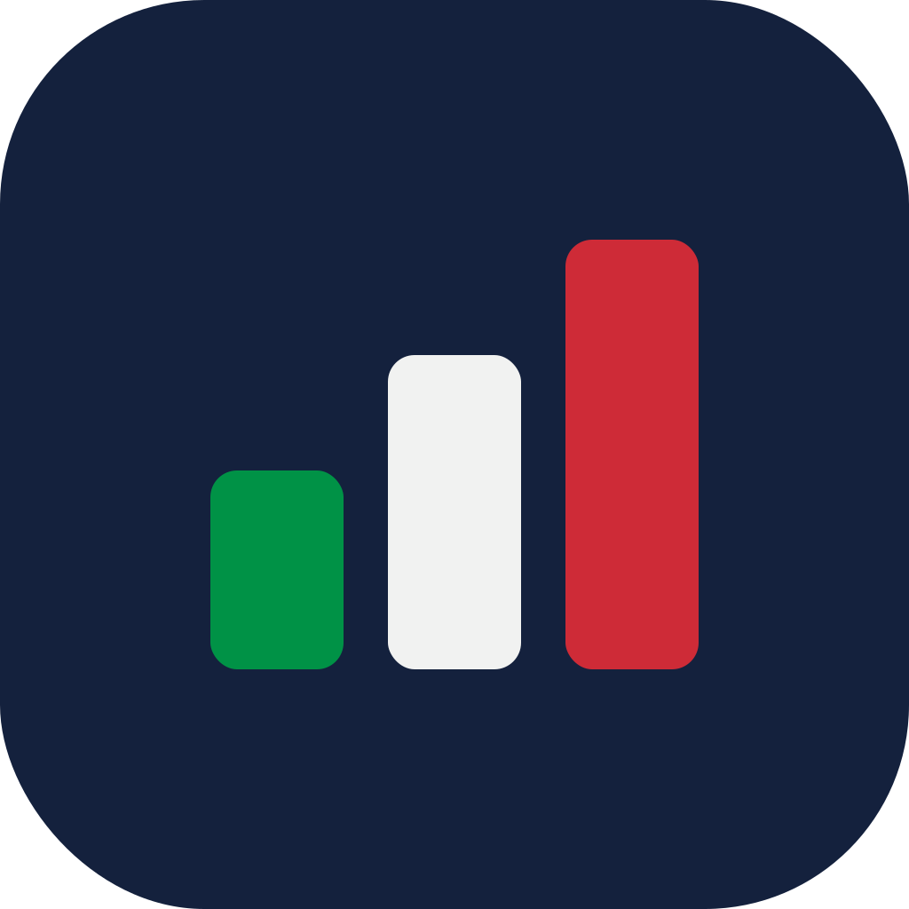
</p>

# ITA 🇮🇹 (ENG below)

Portfolio Manager è un'applicazione per la gestione ed analisi di portafogli finanziari, **nata per risolvere un problema personale: aggregare, in un unico spazio, tutti i propri conti titoli**. Volevo qualcosa che:

- Mi evitasse il dover controllare le varie app delle banche una per una
- Potesse sostituire il classico foglio Excel, poco pratico da telefono e meno intuitivo per gli inesperti
- Offrisse una suite di analisi di portafoglio completa, aggregando i dati di tutti i miei conti
- **Considerasse la tassazione e le leggi italiane**

> *E non esiste già?*

- Esiste l'ottimo [Portfolio Performance](https://github.com/portfolio-performance/portfolio), che inizialmente ho provato ad usare, ma che purtroppo non risolve un problema enorme: **la gestione della tassazione italiana, e le logiche di funzionamento dello zainetto fiscale.**

Questa app è dunque pensata per investitori privati che desiderano tracciare in modo dettagliato le proprie operazioni, la liquidità, il calcolo delle plusvalenze/minusvalenze e la gestione dello zainetto fiscale secondo la normativa italiana, oltre a vari tools per analisi dettagliate (dettagli sotto).

Realizzata con [Flet](https://flet.dev/), è pensata principalmente per uso mobile (Android, in futuro iOS), ma supporta anche Linux, macOS, Windows.


## Funzionalità principali

- **Gestione multi-conto**: supporto a più account con alias personalizzabili
- **Operazioni su liquidità**: depositi, prelievi, trasferimenti tra conti, dividendi, imposte
- **Operazioni su titoli**: acquisto e vendita di azioni ed ETF, con gestione valuta (EUR/USD), commissioni e TER (supporto alle obbligazioni in arrivo)
- **Panoramica del portafoglio** con posizioni aperte, P&L e prezzi in tempo reale (Yahoo Finance)
- **Watchlist** di titoli personalizzabile
- **Lista dei movimenti con esportazione CSV** delle transazioni con campi dettagliati
- **Strumenti di analisi di portafoglio e di rischio** (dettagli sotto)
- **Multilingua**: italiano e inglese

<table>
  <tr>
    <td align="center"><br><b>Home, Watchlist</b></td>
    <td align="center"><br><b>Home, Posizioni Aperte</b></td>
    <td align="center"><br><b>Home Dark, Hidden, ENG</b></td>
    <td align="center"><br><b>Gestione multi-utente</b></td>
  </tr>
  <tr>
    <td align="center">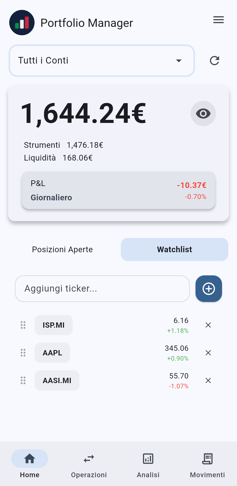</td>
    <td align="center">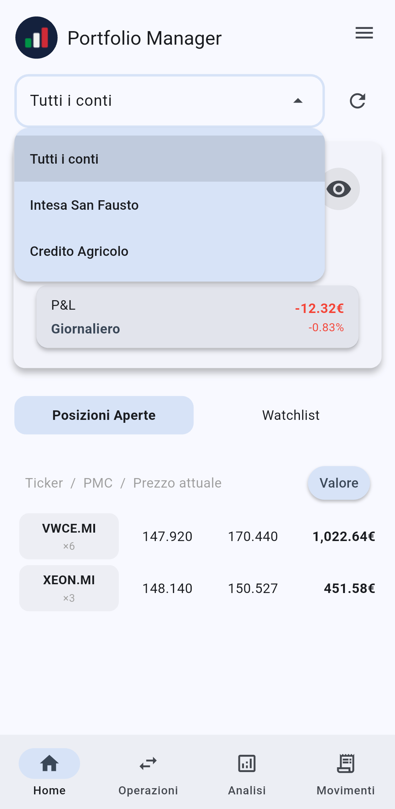</td>
    <td align="center">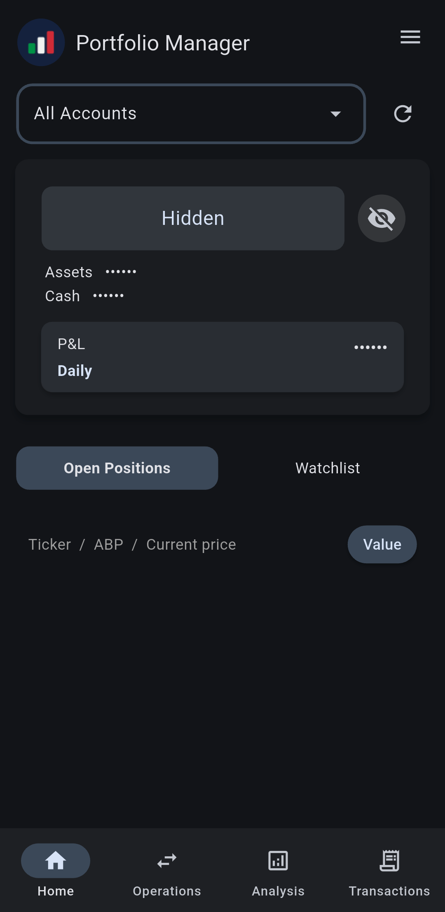</td>
    <td align="center">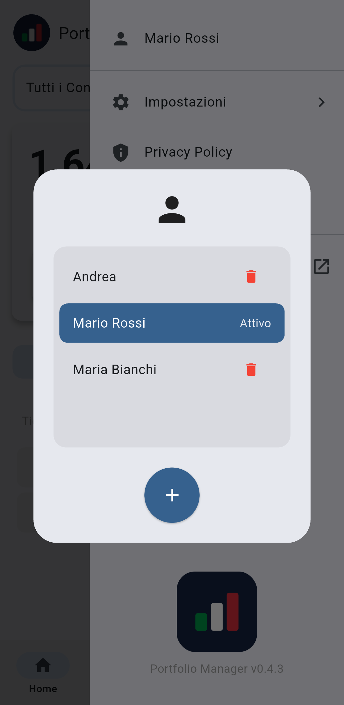</td>
  </tr>
  <tr>
    <td align="center"><br><b>Operazioni</b></td>
    <td align="center"><br><b>Operazioni</b></td>
    <td align="center"><br><b>Allocazione</b></td>
    <td align="center"><br><b>Allocazione</b></td>
  </tr>
  <tr>
    <td align="center">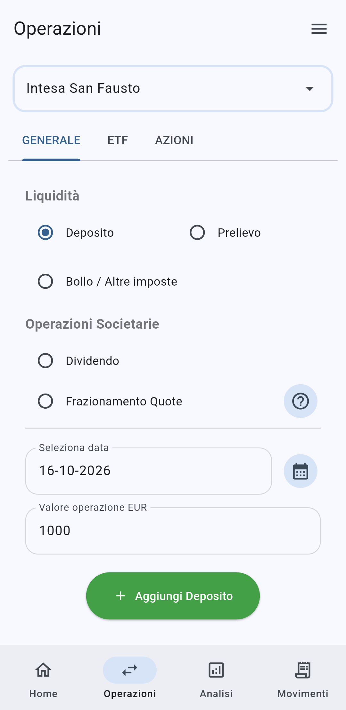</td>
    <td align="center">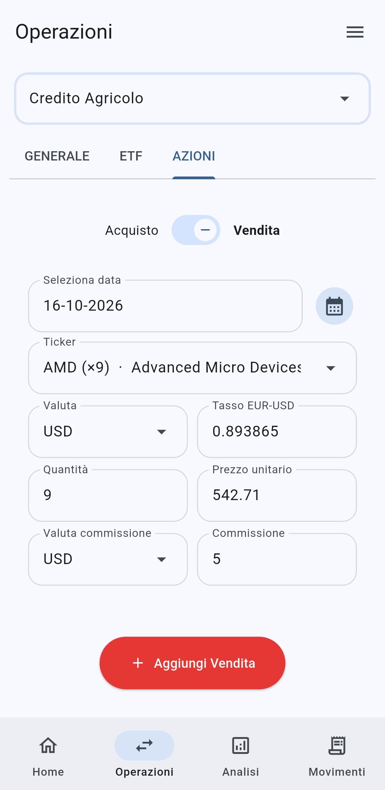</td>
    <td align="center">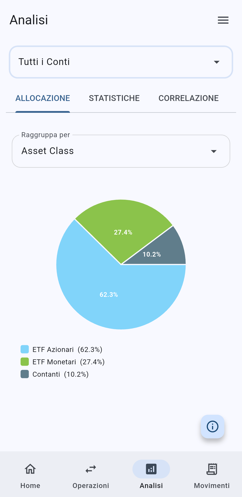</td>
    <td align="center">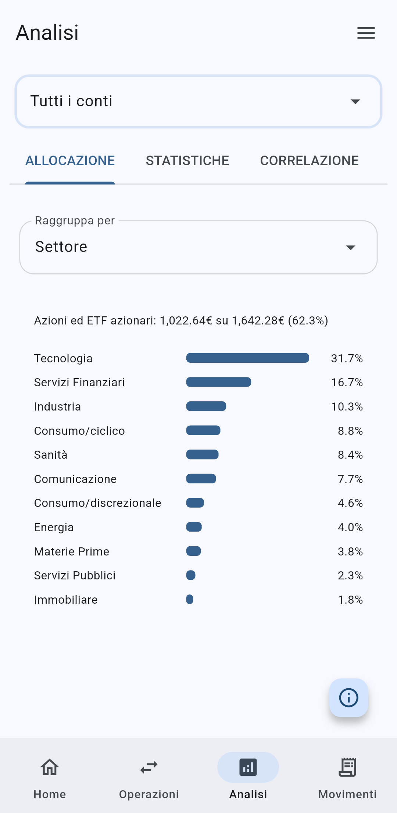</td>
  </tr>
  <tr>
    <td align="center"><br><b>Lista movimenti</b></td>
    <td align="center"><br><b>Andamento Portafoglio</b></td>
    <td align="center"><br><b>Value at Risk</b></td>
    <td align="center"><br><b>Impostazioni</b></td>
  </tr>
  <tr>
    <td align="center">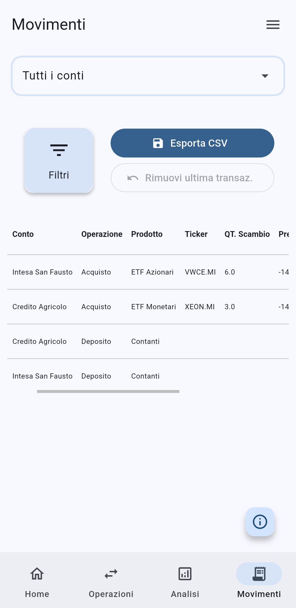</td>
    <td align="center">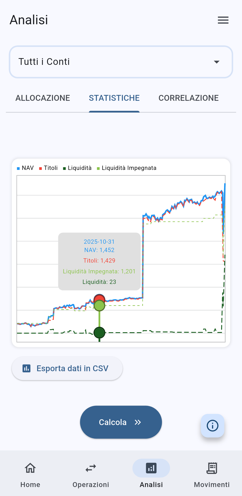</td>
    <td align="center">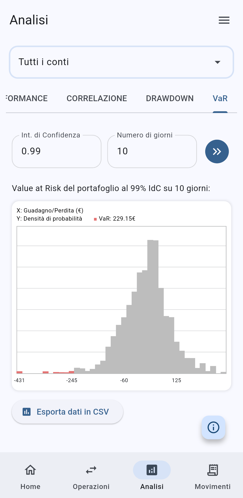</td>
    <td align="center">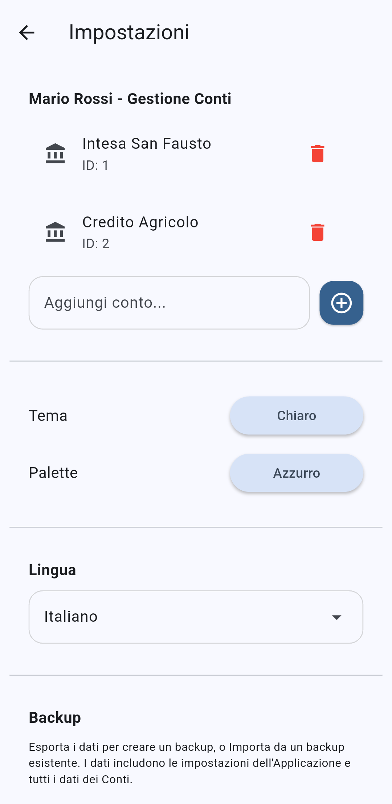</td>
  </tr>
</table>


## Applicazione

Quattro schermate principali:

- **HOME**: Panoramica conto, posizioni aperte, watchlist
- **OPERAZIONI**: Inserimento di nuove transazioni, supporto EUR/USD. Le transazioni vengono salvate automaticamente ad ogni inserimento.
    - *Liquidità* (depositi, prelievi, trasferimenti tra conti, dividendi, imposte)
    - *ETF Azionari, ETF Monetari* (acquisto/vendita) 
    - *Azioni* (acquisto/vendita)
    - **In programma:** *ETF Obbligazionari, Obbligazioni*
- **ANALISI**: strumenti per l'analisi del portafoglio. È presente un tasto Info per ogni strumento, con informazioni a riguardo.
    - *Allocazione* per asset class e settore
    - *Statistiche generali*: principali statistiche del portafoglio con grafico
    - *Correlazione*: correlazione semplice tra asset in portafoglio e correlazione rolling tra due asset selezionati
    - *Drawdown*: calcolo e grafico del drawdown del portafoglio
    - *Value at Risk*: simulazione Monte Carlo su serie storiche con intervallo di confidenza e orizzonte temporale personalizzabili
- **TRANSAZIONI**: storico delle transazioni filtrabile + esportazione in tabella CSV. È presente un tasto Info con informazioni riguardo le colonne del report CSV.


## Backups

È possibile **esportare ed importare backup** completi dell'applicazione, comprendenti tutto: ogni utente, ogni broker, ogni impostazione principale.

Essendo l'app **local-only**, questo è l'unico modo per salvare e trasferire le proprie informazioni.


## Primo avvio

**1\. Scelta della lingua**: Italiano, Inglese

**2a\. Importare dati da backup esistente**

**2b\.** Oppure, **Setup dei conti**: nuovo utente ed inserimento degli alias dei propri intermediari (es. *Fineco Principale, Fineco 2, Directa*). I conti possono essere aggiunti o rimossi successivamente dalle impostazioni. Non è possibile rinominare un conto esistente.


## Installazione
### Download diretto
1. Nella sezione "Releases", scarica il programma per il tuo sistema operativo.

### Installazione manuale
1. Clona la repository
2. Installa i pacchetti (richiesto Python >= 3.11, testato con 3.13). Le versioni sono fissate come in `pyproject.toml`:
    - `uv`: esegui `uv sync`
    - `pip`:
```sh
pip install "flet==1.0.3" "flet-charts==1.0.3" "numpy==2.4.6" "pandas==3.0.3" "python-dateutil>=2.8.2"
```
3. (Opzionale) Per testare l'applicazione: 
  - `uv`: `uv run flet run main.py`
  - `pip`: `python main.py` oppure `flet run`

4. Build dell'applicazione:
  - `uv`: `uv run flet build <target> --project "Portfolio Manager"`
  - `pip`: `flet build <target> --project "Portfolio Manager"`
  - `<target>` == `apk`, `ios`, `linux`, `macos`, `windows`


## Note

- L'inserimento delle transazioni è esclusivamente sequenziale (cronologico)
- Il software è pensato per uso personale e didattico. Non costituisce consulenza finanziaria
- La logica fiscale segue la normativa italiana vigente al 2026; si consiglia sempre la verifica con un consulente

---

<p align="center">
  
</p>

# ENG 🇬🇧 🇺🇸

Portfolio Manager is an application for managing and analyzing financial portfolios, **born to solve a personal issue: bringing all my brokerage accounts together in one place**. I wanted something that:

- Saved me from checking each bank's app one by one
- Could replace the classic Excel spreadsheet, impractical on a phone and less intuitive for beginners
- Offered a complete suite of portfolio analysis tools, combining the data of all my accounts
- **Took Italian taxation and laws into account**

> *Doesn't this exist already?*

- There is the excellent [Portfolio Performance](https://github.com/portfolio-performance/portfolio), which I first tried to use, but which unfortunately doesn't solve a huge problem: **Italian taxation, and how the tax loss carryforward (*zainetto fiscale*) works.**

This app is therefore designed for private investors who want to track in detail their operations, liquidity, capital gains/losses and tax loss carryforward according to Italian regulations, along with various tools for in-depth analysis (details below).

Built with [Flet](https://flet.dev/), it is mainly designed for mobile use (Android, iOS in the future), but it also supports Linux, macOS, Windows.


## Main Features

- **Multi-account management**: support for multiple accounts with custom aliases
- **Cash operations**: deposits, withdrawals, transfers between accounts, dividends, taxes/charges
- **Securities operations**: buying and selling stocks and ETFs, with currency handling (EUR/USD), fees and TER (bond support coming soon)
- **Portfolio overview** with open positions, P&L and live prices (Yahoo Finance)
- **Customizable watchlist**
- **Transactions list with CSV export**, with detailed fields
- **Portfolio and risk analysis tools** (details below)
- **Multilingual**: English and Italian


## Application

Four main tabs:

- **HOME**: account overview, open positions, watchlist
- **OPERATIONS**: entry of new transactions, EUR/USD support. Transactions are saved automatically as they are entered.
    - *Cash* (deposits, withdrawals, transfers between accounts, dividends, taxes/charges)
    - *Equity ETFs, Money Market ETFs* (buy/sell)
    - *Stocks* (buy/sell)
    - **Planned:** *Bond ETFs, Bonds*
- **ANALYSIS**: portfolio analysis tools. There is an Info button for each tool, describing it.
    - *Allocation* by asset class and sector
    - *General statistics*: main portfolio statistics with a chart
    - *Correlation*: simple correlation between held assets, and rolling correlation between two selected assets
    - *Drawdown*: calculation and chart of the portfolio's drawdown
    - *Value at Risk*: Monte Carlo simulation on historical data, with customizable confidence interval and time horizon
- **TRANSACTIONS**: filterable transaction history + CSV export. There is an Info button describing the columns of the CSV report.


## Backups

You can **export and import complete backups** of the application, which include everything: every user, every broker, every main setting.

Since the app is **local-only**, this is the only way to save and transfer your data.


## First Launch

**1\. Language selection**: English, Italian

**2a\. Import data from an existing backup**

**2b\.** Or, **account setup**: a new user and the aliases of your brokers (e.g. *Fineco Main, Fineco 2, Directa*). Accounts can be added or removed later from Settings. Existing accounts cannot be renamed.


## Installation
### Direct Download
1. In the "Releases" section, download the program for your operating system.

### Manual Installation
1. Clone the repository
2. Install packages (requires Python >= 3.11, tested with 3.13). The versions are pinned as in `pyproject.toml`:
  - `uv`: run `uv sync`
  - `pip`:
```sh
pip install "flet==1.0.3" "flet-charts==1.0.3" "numpy==2.4.6" "pandas==3.0.3" "python-dateutil>=2.8.2"
```
3. (Optional) To test the application:
  - `uv`: `uv run flet run main.py`
  - `pip`: `python main.py` or `flet run`
4. App building:
  - `uv`: `uv run flet build <target> --project "Portfolio Manager"`
  - `pip`: `flet build <target> --project "Portfolio Manager"`
  - `<target>` == `apk`, `ios`, `linux`, `macos`, `windows`


## Notes

- Transaction entry is exclusively sequential (chronological)
- This software is intended for personal and educational use. It does not constitute financial advice
- The fiscal logic follows Italian regulations in force as of 2026; always verify with a professional advisor
